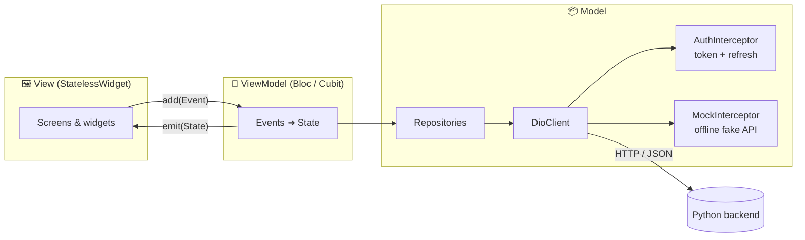

<div align="center">

# 💗 Amora

### Meet someone worth staying for.

A dating **and** relationship app. Swipe, match and chat like you already know how,
then turn a match into a couple with a shared space just for the two of you.

[](https://flutter.dev)
[](https://dart.dev)
[](https://bloclibrary.dev)
[](https://pub.dev/packages/dio)
[](docs/API_CONTRACT.md)

[](https://github.com/Abdulsathar27/amora-dating-app/actions/workflows/flutter-ci.yml)
[](LICENSE)
[](CONTRIBUTING.md)

[Features](#-features) •
[Architecture](#-architecture) •
[Getting started](#-getting-started) •
[API](#-backend-api) •
[Roadmap](#-roadmap) •
[Contributing](#-contributing)

</div>

---

## ✨ Features

<table>
<tr>
<td width="50%" valign="top">

### 🔥 Discover
- Swipe cards: **drag right to like, left to pass, up to super like**
- Live **LIKE / NOPE / SUPER LIKE** stamps while dragging
- Tap left/right on a card to browse photos
- **Rewind** your last pass
- Filters: age, distance, gender, verified only

</td>
<td width="50%" valign="top">

### 💘 Match
- **"It's a Match!"** screen on mutual likes
- New matches **expire after 24h** without a message
- Optional **first-move** rule decided by the backend
- **Likes You** screen: like back or pass, with comments and super likes

</td>
</tr>
<tr>
<td valign="top">

### 💬 Chat
- Conversation list with unread badges
- **Icebreakers** generated from the other person's prompts and interests
- Day dividers, timestamps, unmatch
- Ask a match to **be your partner** from the chat menu

</td>
<td valign="top">

### 💑 Us — the relationship space
- Partner requests (send / accept / decline)
- **Days together** counter and **anniversary countdown**
- Daily **mood check-ins** you can both see
- Shared **date plans** and a **memories** timeline

</td>
</tr>
<tr>
<td colspan="2" valign="top">

### 👤 Profile
Six-step onboarding (basics, gender, intention, bio, prompt, interests), Hinge-style prompts,
dating intention (long-term, marriage, casual, figuring it out), profile completeness ring, edit and preview mode.

</td>
</tr>
</table>

> Feature ideas come from common patterns in apps like Tinder, Bumble, Hinge and Aisle.
> All code, names and visuals in this repository are original.

---

## 🏗 Architecture

**MVVM + BLoC**. Every screen is a `StatelessWidget`; all state lives in a Bloc or Cubit.



| Layer | Folder | Responsibility |
|---|---|---|
| **View** | `lib/features/*/view` | Renders state with `BlocBuilder` / `BlocListener`. No `StatefulWidget`, no `TextEditingController`. |
| **ViewModel** | `lib/features/*/view_model` | Blocs and Cubits. Turns user events into state, calls repositories. |
| **Model** | `lib/data` | Models with `fromJson` / `toJson`, and repositories that call the API. |
| **Core** | `lib/core` | Dio client, interceptors, dependency injection (`get_it`), theme, router, shared widgets. |

<details>
<summary><b>📁 Project structure</b></summary>

```
lib/
├── main.dart
├── app.dart                     # auth gate: splash → login → onboarding → home
├── core/
│   ├── config/                  # AppConfig (base URL, mock switch)
│   ├── di/                      # get_it registrations
│   ├── network/                 # DioClient, AuthInterceptor, MockInterceptor, ApiException
│   ├── router/                  # pushed routes
│   ├── storage/                 # token storage
│   ├── theme/                   # colors, light/dark theme
│   └── widgets/                 # shared stateless widgets, ValueCubit
├── data/
│   ├── models/                  # user, profile, match, message, discovery, relationship
│   └── repositories/            # auth, profile, discovery, match, relationship
└── features/
    ├── auth/         ├── onboarding/   ├── home/
    ├── discovery/    ├── likes/        ├── matches/
    ├── chat/         ├── profile/      └── relationship/
        each with view/ and view_model/
```

</details>

### Tech stack

| | Package |
|---|---|
| State management | `flutter_bloc`, `equatable` |
| Networking | `dio` |
| Dependency injection | `get_it` |
| Storage | `shared_preferences` |
| Formatting | `intl` |
| Testing | `bloc_test`, `mocktail` |

---

## 🚀 Getting started

**Requirements:** Flutter 3.44+ (Dart 3.12+), Android Studio or Xcode.

```bash
git clone https://github.com/Abdulsathar27/amora-dating-app.git
cd amora-dating-app
flutter pub get
flutter run
```

The app runs **without a backend**: a built-in mock API answers every request with sample profiles, matches and chats.
Log in with any email and a password of 6+ characters.

### Connect to the real backend

```bash
flutter run --dart-define=USE_MOCK_API=false --dart-define=API_BASE_URL=http://10.0.2.2:8000/api/v1
```

`10.0.2.2` points to your computer from the Android emulator. Use your machine's LAN IP on a real phone.

### Run checks

```bash
flutter analyze
flutter test
```

---

## 🔌 Backend API

The Python backend is built against **[docs/API_CONTRACT.md](docs/API_CONTRACT.md)**, which lists every endpoint and JSON shape the app uses:

| Area | Endpoints |
|---|---|
| Auth | `/auth/register` `/auth/login` `/auth/refresh` `/auth/logout` `/auth/me` |
| Profile | `/profiles/me` `/profiles/{id}` |
| Discovery | `/discovery/feed` `/discovery/swipe` `/discovery/rewind` `/discovery/preferences` `/likes/received` |
| Chat | `/matches` `/matches/{id}` `/matches/{id}/messages` |
| Relationship | `/relationship` `/relationship/request` `/respond` `/end` `/date-plans` `/memories` `/check-ins` |

---

## 🗺 Roadmap

- [x] Flutter app: auth, onboarding, swipe deck, likes, matches, chat, profile
- [x] Relationship space: partner requests, mood check-ins, date plans, memories
- [x] Offline mock API and bloc tests
- [ ] Python backend (FastAPI + PostgreSQL)
- [ ] Photo upload (multipart) and photo verification
- [ ] Real-time chat over WebSocket
- [ ] Push notifications (FCM)
- [ ] Block and report
- [ ] Secure token storage (`flutter_secure_storage`)

---

## 🤝 Contributing

Contributions are welcome. Read **[CONTRIBUTING.md](CONTRIBUTING.md)** and follow the
**[Code of Conduct](CODE_OF_CONDUCT.md)**. Security issues: see **[SECURITY.md](SECURITY.md)**.

## 📄 License

Released under the [MIT License](LICENSE).

<div align="center">

---

Made with 💗 by [Abdulsathar27](https://github.com/Abdulsathar27)

⭐ Star the repo if you like it!

</div>
